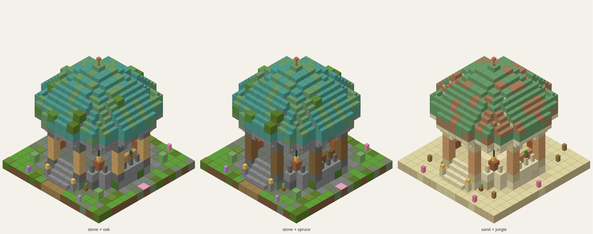

# Spawn Gazebo

A Fabric mod for Minecraft 26.3. New worlds start in a little round stone gazebo instead of a random patch of grass.



## What you get

- **A round gazebo at the world spawn**, built once when a world is created. A round stepped plinth, eight pillars of stripped logs on stone bases, arched openings on four sides, a carved stone band, and a dome of weathered copper with a lightning rod on top. Inside, a coffered ceiling rises to a spore blossom over a glowstone floor, with two benches, flower pots holding saplings and a cactus, and four decorated pots hiding mangrove propagules, bamboo and seeds (break them to get what's inside).
- **Built from what's around it.** The pillars and benches are the wood that grows nearest the spawn: oak, spruce, birch, jungle, acacia, dark oak, mangrove, cherry, pale oak, bamboo or poplar. In deserts and badlands the stone is sandstone and the dome a browner copper; everywhere else it's grey stone with moss creeping in and azaleas growing over the dome.
- **A starter chest**, in the railing opposite the entrance, like vanilla's bonus chest: a bed, sixteen torches, six bread, four saplings and a bundle. Or, if you'd rather, the bonus chest's own loot (a few tools, wood, food and seeds, different every time), or any loot table you name. The first player takes the chest; everyone who joins after them is handed a roll of the same loot. With [Lootr](https://modrinth.com/mod/lootr) installed, each player gets their own copy of the chest instead.
- **Lanterns** hang under the eaves and stand either side of the steps, so the spawn is lit at night.
- **Protection.** Outside creative the gazebo can't be broken or built on, and explosions, fire, pistons and buckets leave it alone. The chest, benches and pots still work, and the decorated pots can still be broken for their contents. The protection reaches 12 blocks from the middle of the gazebo (the gazebo itself reaches 7), so the lawn around it stays as it was; the radius is a setting.

Building it also moves the world spawn to the middle of the gazebo and sets the `spawn_radius` game rule to 0, so everyone starts inside it. Any lava pool at the surface within 16 blocks (or the protected radius, if that's wider) is set to stone, so nobody's first steps outside are into lava.

## Settings

In `config/spawn_gazebo.properties`, or in game through [Mod Menu](https://modrinth.com/mod/modmenu) (Spawn Gazebo > Config):

| Setting | Default | What it does |
|---|---|---|
| `spawnGazebo` | on | Build the gazebo in new worlds. Only matters when a world is created. |
| `starterChest` | on | Put the starter chest in the gazebo. Off, the railing runs across its spot and no kit is handed out. Only matters when a world is created. |
| `chestLoot` | `starter_kit` | What the chest holds: `starter_kit`, `bonus_chest` (vanilla's bonus chest loot), or any loot table id, such as `minecraft:chests/village/village_plains_house`. Only matters when a world is created. |
| `protectGazebo` | on | Keep the gazebo from being changed outside creative. Switch off to remodel it. |
| `protectedRadius` | 12 | How far from the middle of the gazebo the protection reaches, in blocks: 7 is the gazebo itself, up to 64. |

On a server, the server's settings file decides; players' own settings are greyed out there.

## Worlds

Only brand-new worlds get the gazebo. Worlds from before the mod keep their spawn as it is. Removing the mod leaves the gazebo standing as ordinary blocks.

## Requirements

Fabric Loader 0.19.5 or newer, Fabric API, Minecraft 26.3, Java 25. Mod Menu and Lootr are optional.

## Building

```
./gradlew build
```

The jar lands in `build/libs/`. The structure files and the data pack are generated by `node tools/generate-data.js`; edit `tools/generate-spawn.js` to change the gazebo and re-run it. The icon and the picture above are drawn from those structure files with the game's own block textures by `node tools/render-gazebo.js` (add `--docs` for the picture); it reads the textures from the Minecraft client jar.

`./gradlew runClientGameTest` starts the game and checks the settings file (typos, unknown settings, safe saving), the settings screen from the title screen, in a world and on a server (where it's greyed out), that changes are saved, that a new world gets its gazebo, and that a survival player can't break, build or dig a path inside the protected radius but can just outside it. Screenshots land in `build/run/clientGameTest/screenshots`.

## Licence

MIT. See [LICENSE](LICENSE).
